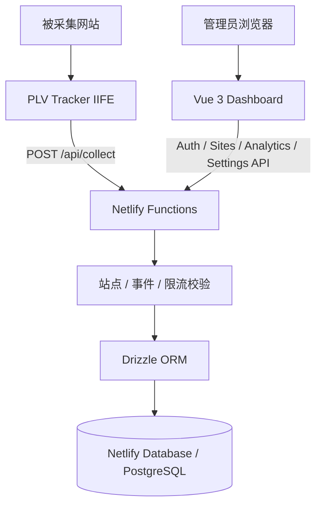
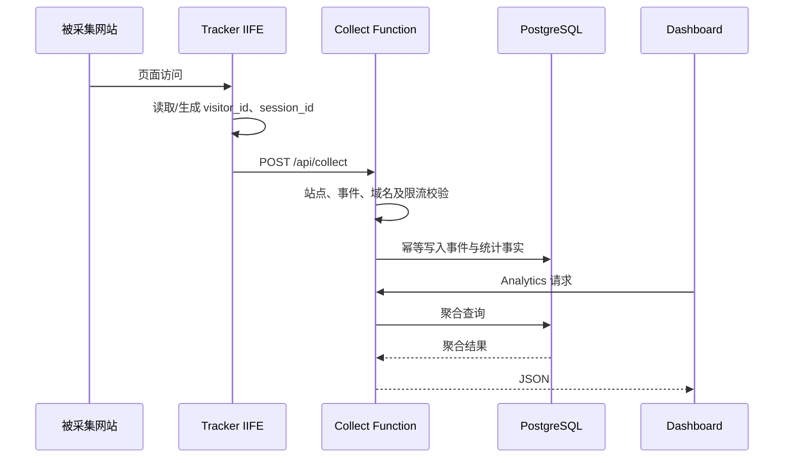

| 文档编号 | 文档类型 | 文档状态 | 最后更新 | 作者 |
| :---: | :---: | :---: | :---: | :---: |
| `PLV-SITE-MONITOR-V1-ARCH-001` | ARCH / 技术架构 | 🟢 已发布 | 2026-11-24 | 吖飘 |

# PLV Site Monitor 技术架构与数据链路

**摘要**：合并记录系统拓扑、技术选型、数据库与隐私规则、Tracker/Collect、安全边界及生产部署约束。

## 1. 总体架构



## 2. 技术组成

| 层 | 技术 | 职责 |
| :--- | :--- | :--- |
| Tracker | 浏览器端 IIFE SDK | 被采集站点页面访问采集 |
| API | Netlify Functions | Collect、Auth、Sites、Analytics、Settings |
| Database | PostgreSQL / Netlify Database | 业务数据及统计数据持久化 |
| ORM | Drizzle ORM | Schema、查询及迁移 |
| Dashboard | Vue 3、TypeScript、Pinia、ECharts、Tailwind CSS、Vue Router | 管理与统计界面 |
| Quality | Vitest、TypeScript 检查、构建、浏览器验收 | 质量验证 |
| Hosting | Netlify | 静态托管与 Functions 运行 |

## 3. 数据访问与安全边界

- Tracker 不直接连接数据库。
- Dashboard 不直接连接数据库。
- 数据访问经 Netlify Functions API。
- 管理 API 使用管理员认证与会话校验。
- Collect 为公开入口，执行站点、域名/访问范围、事件及限流校验。
- 前端路由守卫只负责体验层控制，不能替代服务端认证。

## 4. 数据模型与身份

核心实体包括 `sites`、`site_domains`、`page_events`、`admin_users`、`admin_sessions`、`system_settings`、`site_rate_limit_counters`、`analytics_event_facts`、`analytics_session_facts` 及 `analytics_daily_*` 聚合/Membership 数据。字段、类型、索引、外键和约束以当前 `db/schema.ts`、Analytics Schema 与 Migration 为准。

- `event_id` 标识事件；通过 `UNIQUE(site_id, event_id)` 防止重复事件重复写入。
- `visitor_id` 为 UUID v4，优先使用 localStorage。
- `session_id` 为 UUID v4，优先使用 sessionStorage。
- 浏览器存储不可用时采用内存降级。
- 服务端校验标识格式，并负责服务端 Session 生命周期与归属逻辑。

## 5. 隐私与数据保留

| 数据 | 已确认规则 |
| :--- | :--- |
| 原始事件 | 最长保留 90 天 |
| 原始 IP | 最长保留 30 天，到期将 `ip_address` 置为 `NULL` |
| 原始 User-Agent | 最长保留 30 天 |
| 原始 Visitor ID / Session ID | 随原始事件最长保留 90 天 |
| Analytics Event Facts / Session Facts | 长期保留 |
| 历史聚合数据 | 长期保留 |

其他规则：IP 从服务端 Netlify Context 获取，不信任客户端自报 IP；不保存 `ip_hash`，不实现 HMAC IP Hash；URL 入库前移除 fragment 并清理敏感查询参数，具体名单以代码和测试为准；GeoIP 来源及字段映射以实现为准。HMAC 环境变量用于 Analytics 身份相关处理，不得误述为 IP Hash 密钥。

## 6. 管理员认证

- 单一管理员记录，`admin_users` 使用固定单例 ID。
- 密码哈希使用 Node.js `crypto.scrypt`。
- Session Token 为 32 字节 Base64URL 随机值，数据库仅保存 SHA-256 Token Hash。
- Session 有效期 7 天。
- Production Cookie：`__Host-plv_admin_session`，Secure、HttpOnly、SameSite=Lax、Path=/。
- 本地开发 Cookie：`plv_admin_session`。
- 认证失败采用 fail-closed。不得改变 Analytics 既有会话语义。

## 7. 采集限流

- 每个 Site ID 独立计数。
- 固定 60 秒窗口，不开放窗口长度配置。
- 默认每站点每 60 秒最多 600 次请求，可配置范围 1–10000。
- 超限返回 HTTP 429 / `RATE_LIMITED`。
- 配置复用 `system_settings` 单例；计数存放 `site_rate_limit_counters`。
- 使用 `(site_id, window_start)` 唯一约束与 PostgreSQL 原子 UPSERT 处理并发。

## 8. Tracker 与 Collect 链路



当前 MVP 核心事件为 `page_view`。外部接入应使用 Dashboard 为目标站点生成的完整代码，不应手工猜测 Site ID 或替换实际 API 配置。

## 9. Production 拓扑与发布

| 项目 | 已记录值 |
| :--- | :--- |
| Netlify Site | `plv-monitor` |
| Production URL | https://plv-monitor.netlify.app |
| Production branch | `master` |
| GitHub | https://github.com/plvLY/PLV-Site-Monitor |
| Tracker 验证站点 | https://plvstudio.netlify.app |
| Database | Netlify Database / PostgreSQL |

发布工作流：本地开发 → Gitee primary `origin` → GitHub 同步（`master`）→ Netlify Production Deploy。

构建配置基线：

```toml
[build]
  command = "npm --prefix dashboard ci && npm --prefix dashboard run build"
  publish = "dashboard/dist"
  functions = "netlify/functions"

[dev]
  port = 8888
  targetPort = 5173
  command = "npm --prefix dashboard run dev -- --host 127.0.0.1"

[[redirects]]
  from = "/*"
  to = "/index.html"
  status = 200
```

## 10. Migration 与生产安全

 已应用 8 个 Migration、Pending migrations = 0：

1. `20261105111100_create_analytics_tables`
2. `20261108094043_motionless_psylocke`
3. `20261111115419_add_analytics_tables`
4. `20261111115945_add_membership_dimension_check`
5. `20261112180000_add_system_settings`
6. `20261114134732_add_admin_auth`
7. `20261117161557_add_site_rate_limit_counters`
8. `20261118084825_add_site_rate_limit_setting`

该清单仅代表截至 2026-11-19 的历史快照，后续状态待重新核验。文档整理不得触发生产 Migration、数据库重置、管理员重建或数据删除；任何生产 Migration 必须核对现状、影响范围并取得用户明确授权。

---

### 📝 变更记录

* `v1.0.0`
  - **(2026-11-06)** 初始架构文档内容产生。
  - **(2026-11-14)** 确认管理员 Cookie 与 Session 安全方案：生产/本地 Cookie 名称区分、32 字节 Token、仅存 SHA-256、7 天有效期。
  - **(2026-11-17)** Migration 记录新增每站点限流计数器表。
  - **(2026-11-18)** 确认固定 60 秒限流窗口、默认 600、可配置范围 1–10000，并新增限流配置 Migration。
  - **(2026-11-24)** 按 PLV 项目文档管理规范整理并发布。
