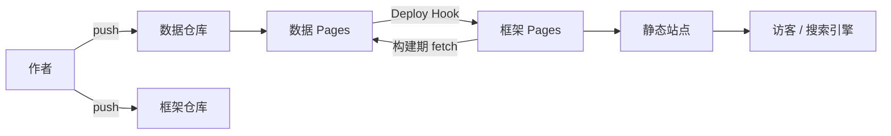

# 系统架构设计

## 总体结构

## 框架分层

- `pages`：路由与页面编排。
- `layouts`：BaseLayout、PageLayout、DocLayout。
- `components`：layout / ui / project / progress / docs。
- `lib/data-source`：唯一的数据访问入口。
- `lib/contracts`：Zod Schema 与类型。
- `lib/derive`：进度、最近更新、发布日志等派生。
- `lib/markdown`、`lib/mermaid`、`lib/seo`。

## 关键决策

| 决策 | 结论 | 理由 |
|------|------|------|
| 数据获取 | 构建期 fetch | SEO 完整、无首屏闪烁 |
| 输出模式 | `output: 'static'` | 无后端、带宽成本最低 |
| 图表 | 构建期渲染为 SVG | 页面不加载 Mermaid 运行时 |
| 校验 | 构建期 Zod | 错误在发布前暴露 |
| 图片 | 封面/头像构建期优化 | 控制 LCP |

## 数据流

数据仓库 push → 数据项目部署 → Deploy Hook → 框架项目 `check && build` → `dist` 发布。每次数据更新消耗 2 次 production build，月均约 62 / 500。

## 失败策略

契约错误、`DATA_BASE` 缺失、图片 404、路由冲突均中止构建，不允许带病发布。
